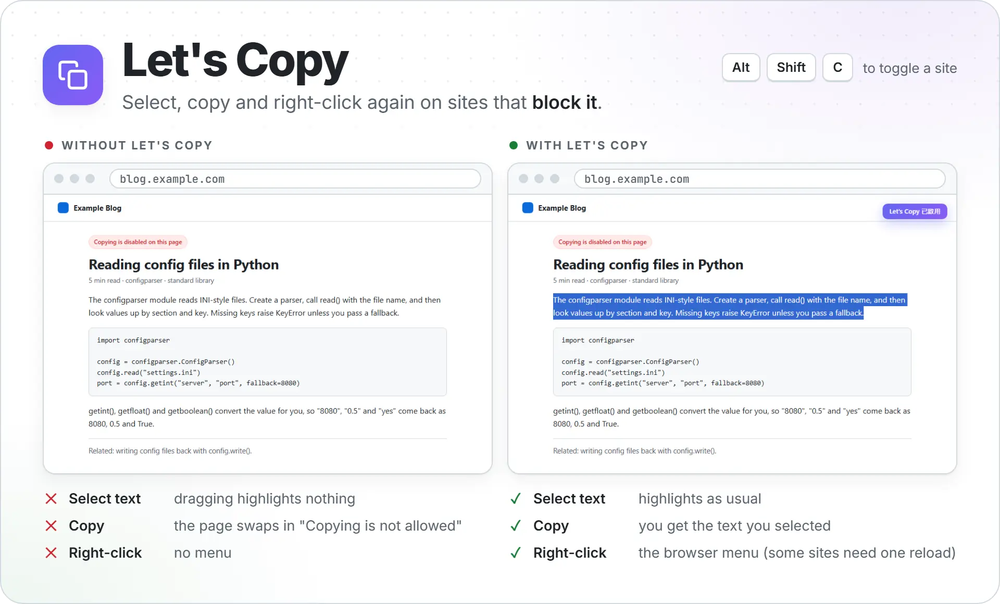
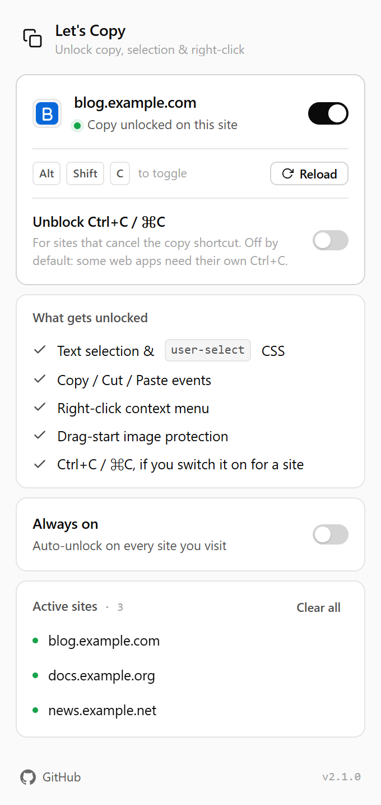
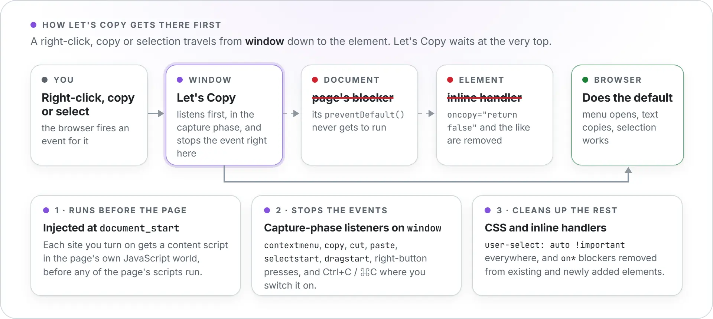

<p align="center">
  <picture>
    <source media="(prefers-color-scheme: dark)" srcset="docs/images/hero-dark.webp">
    
  </picture>
</p>

<p align="center">
  <a href="https://github.com/NatLee/lets-copy/actions/workflows/validate.yml"></a>
  <a href="https://chromewebstore.google.com/detail/lets-copy/ggibadcfmilllfefhfbpifbamabehfdd"></a>
  <a href="https://chromewebstore.google.com/detail/lets-copy/ggibadcfmilllfefhfbpifbamabehfdd"></a>
  <a href="https://github.com/NatLee/lets-copy/releases/latest"></a>
</p>

Let's Copy is a browser extension for Chrome and Edge that gives you back text selection, copy and
the right-click menu on websites that switch them off. Turn it on for a site with one click or
`Alt+Shift+C`, and it stays on for that site from then on. Or switch on **Always on** for every site.
It runs entirely in your browser: no account, no tracking, and nothing is sent anywhere.

## Install

**From the Chrome Web Store:** [Let's Copy](https://chromewebstore.google.com/detail/lets-copy/ggibadcfmilllfefhfbpifbamabehfdd).
Edge can install it from the same page once you turn on *Allow extensions from other stores*.

**From a release:** download `lets-copy-vX.Y.Z.zip` from the
[Releases page](https://github.com/NatLee/lets-copy/releases/latest) and unzip it. Then:

1. Open `chrome://extensions` (or `edge://extensions`) and switch on **Developer mode**.
2. Click **Load unpacked** and pick the unzipped folder.

**From source:** clone the repo and do the same with the `src` folder. After editing a file, press the
reload button on the extension's card.

## Usage

Click the Let's Copy button in the toolbar (pin it from the puzzle-piece menu if you don't see it).

<p align="center">
  <picture>
    <source media="(prefers-color-scheme: dark)" srcset="docs/images/popup-dark.png">
    
  </picture>
</p>

- **The switch at the top** turns Let's Copy on or off for the site you're on. `Alt+Shift+C` does the
  same without opening the popup. You can change the shortcut at `chrome://extensions/shortcuts`.
  Turning it on works straight away: the toolbar icon changes to a check mark with an **ON** badge,
  and the page shows a short "Let's Copy 已啟用" notice. Turning it off reloads the page, so the site's own rules
  come back.
- **Reload** appears while a site is on. A few sites install their blockers before Let's Copy can get
  in front of them. On those, right-click starts working after one reload, and from then on every
  visit is unlocked from the start.
- **Always on** unlocks every site you visit. While it's on, the per-site switch and the shortcut do
  nothing, because there is nothing to switch.
- **Active sites** lists the sites you've turned on. Hover over one and click × to remove it. *Clear
  all* asks for a second click, then forgets every site and turns Always on off.

## How it works

<p align="center">
  <picture>
    <source media="(prefers-color-scheme: dark)" srcset="docs/images/how-it-works-dark.webp">
    
  </picture>
</p>

Sites block copying in a handful of ways. They set `user-select: none` in CSS, put
`oncopy="return false"` on elements, or listen for `contextmenu`, `copy` or `selectstart` and cancel
them. Let's Copy deals with all three ([`src/enable.js`](src/enable.js)):

1. For every site you turn on, the service worker ([`src/background.js`](src/background.js)) registers
   a content script that runs at `document_start` in the page's own JavaScript world. That is before
   any of the page's scripts.
2. The script listens for `contextmenu`, `selectstart`, `copy`, `cut`, `paste`, `dragstart` (and the
   right mouse button) on `window`, in the capture phase. That is the first stop of every event, so it
   can stop the event before any of the page's listeners see it. The browser then does what it
   normally does: shows the menu, copies the text, starts the selection.
3. It adds a stylesheet that sets `user-select: auto !important` on everything. It also removes inline
   blockers (`oncontextmenu`, `oncopy`, `onselectstart`, `onmousedown`, `unselectable`, …), including on
   elements the page adds later.

On csdn.net it also switches on `designMode`, which makes CSDN's code blocks selectable.

### Good to know

- **The page's own copy and paste handling is skipped too.** While a site is on, its `copy`, `cut` and
  `paste` listeners never run, including useful ones such as pasting an image into a chat box. If a web
  app misbehaves, turn Let's Copy off for that site, or turn off Always on.
- **Ctrl+C blocked on the keyboard isn't undone.** Some sites cancel the `Ctrl+C` key press itself. On
  those, select the text and use **Copy** from the right-click menu.
- **Turning a site off reloads it.** The unlock can't be undone in a page that's already open.

## Permissions

| Permission | What it is for |
|---|---|
| `storage` | Remembers the sites you turned on and whether Always on is set, in your browser profile. |
| `scripting` | Runs the unlock script on the sites you turned on. |
| Access to all websites (`<all_urls>`) | Lets the unlock script run on whichever site you pick, and lets the popup show which site the current tab is on. |

Let's Copy only runs its script on sites in your list, or on every site while Always on is set.

## Privacy

Nothing leaves your browser. Let's Copy has no analytics and no server, and it keeps its two settings
in `chrome.storage.local` on your computer. The only thing the popup loads is the current tab's own
icon, from the address your browser already found for it (usually straight from the cache). The full
policy is in [PRIVACY.md](PRIVACY.md).

## Development

You need Node.js 20 or newer, but only for the checks. The extension itself has no build step and no
dependencies.

```bash
npm test         # service worker against a fake chrome.* API, plus tests for the checker
npm run check    # manifest, every referenced file and icon, no inline/remote scripts,
                 # syntax, permission and remote-host allowlists
```

The Validate workflow runs both on every pull request.

To try the unlock by hand, serve the demo page and open it with the unpacked extension loaded:

```bash
node docs/images/src/screenshots.mjs --serve     # http://localhost:18006/
```

[`docs/images/src/demo-page.html`](docs/images/src/demo-page.html) blocks copying in seven common
ways; the comment at its top lists them. Without the `--serve` flag, the same script loads the
extension in Edge and retakes the README screenshots. `hero.html` and `how-it-works.html` are rendered
with a headless browser; the command is in each file's header.

```
src/
├── manifest.json   Manifest V3: popup, service worker, shortcut, permissions
├── background.js   service worker: the site list, Always on, script registration, toolbar icon
├── enable.js       the unlock itself, injected into pages
├── popup.html      the popup
├── popup.css       styles, light and dark
├── popup.js        popup logic
└── icons/          toolbar and store icons (check mark = on, copy symbol = off)
test/               node:test tests (fake-chrome.js is the chrome.* stand-in)
scripts/            check-extension.js, behind `npm run check`
docs/images/src/    sources for the README images and the demo page
```

### Packaging and releases

`bash package.sh` (or `.\package.ps1` on Windows PowerShell) builds `lets-copy-vX.Y.Z.zip` at the repo
root, the same file the build workflow makes.

To release, bump `version` in `src/manifest.json`, commit, and run `./release.sh` (or `.\release.ps1`).
The script refuses to tag a version that already exists, pushes the branch, then creates and pushes
an annotated `vX.Y.Z` tag. The [build workflow](.github/workflows/build.yml) checks that the tag
matches the manifest, runs the tests, builds the ZIP, and creates a GitHub Release with it attached.
If a `CRX_PRIVATE_KEY` secret is set, it attaches a signed `.crx` too. Upload the ZIP in the
[Chrome Web Store developer dashboard](https://chrome.google.com/webstore/devconsole) to ship it.

## Icon credits

- Enable: <https://www.flaticon.com/free-icon/check_9902393?related_id=9902393&origin=pack>
- Disable: <https://www.flaticon.com/free-icon/copy_9902369?term=copy&page=1&position=13&origin=search&related_id=9902369>
